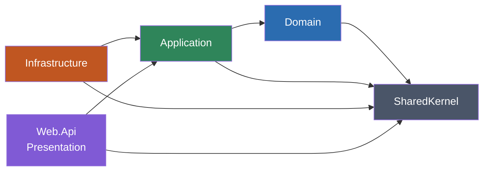
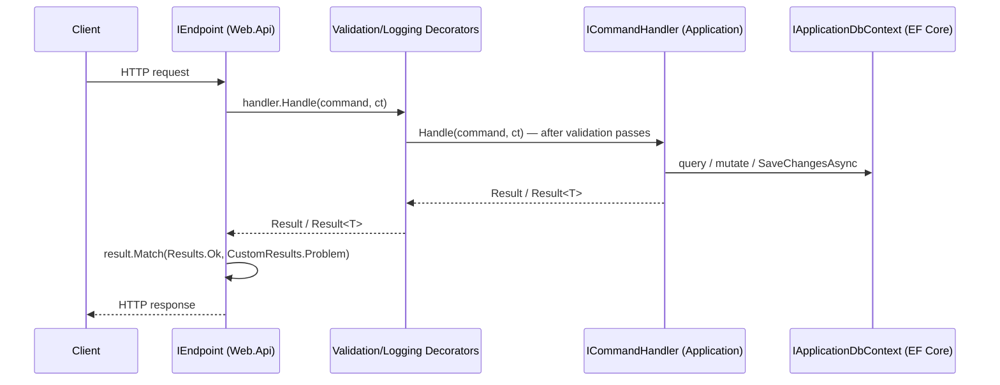

# Clean Architecture Template — Documentation

This is a Clean Architecture template for ASP.NET Core (.NET 10, C# 12). It demonstrates CQRS,
DDD-flavored entities and domain events, minimal-API endpoints, permission-based authorization,
EF Core + PostgreSQL persistence, and Serilog/Seq logging, via a sample `Todos` + `Users` feature
slice. Use this documentation as the reference when building a new project on top of it.

## Stack

- .NET 10 (`net10.0`), C# 12 — see `Directory.Build.props` for retargeting to .NET 8/9.
- ASP.NET Core Minimal APIs (no controllers).
- EF Core 10 + Npgsql (PostgreSQL), `EFCore.NamingConventions` (snake_case).
- FluentValidation, Scrutor (assembly-scanning DI + decoration).
- Serilog + Seq (structured logging).
- JWT bearer authentication + a custom permission-based authorization scheme.
- xUnit + NetArchTest + Shouldly (architecture tests).

## Architecture at a glance

Five projects, one enforced dependency direction, verified by
`tests/ArchitectureTests/Layers/LayerTests.cs` on every build:



| Project | Responsibility |
|---|---|
| `SharedKernel` | `Entity`, `Result`/`Result<T>`, `Error`/`ErrorType`, `IDomainEvent`, `IDateTimeProvider` |
| `Domain` | Entities, domain events, `*Errors` per aggregate (`Todos/`, `Users/`) |
| `Application` | CQRS use cases (commands/queries + handlers), validators, decorators, abstraction interfaces |
| `Infrastructure` | EF Core, JWT auth, permission authorization — implements every `Application` abstraction |
| `Web.Api` | Minimal API endpoints, HTTP composition root, Swagger, exception handling |

Full detail: [architecture/overview.md](./architecture/overview.md),
[architecture/dependency-rules.md](./architecture/dependency-rules.md), and one page per layer
([domain](./architecture/domain.md), [application](./architecture/application.md),
[infrastructure](./architecture/infrastructure.md), [presentation](./architecture/presentation.md)).

## Request flow



## Key architectural decisions

These are deliberate, existing choices — extend them, don't "fix" them by reintroducing the
pattern they replace:

- **No Repository/Unit of Work/Specification layer** — handlers use `IApplicationDbContext`
  directly. [persistence/ef-core.md](./persistence/ef-core.md)
- **No MediatR** — hand-rolled CQRS interfaces + Scrutor scanning.
  [patterns/cqrs.md](./patterns/cqrs.md)
- **`Result`/`Result<T>`, not exceptions, for expected failure.**
  [patterns/result-pattern.md](./patterns/result-pattern.md),
  [patterns/error-handling.md](./patterns/error-handling.md)
- **Minimal APIs, not controllers.** [api/minimal-api.md](./api/minimal-api.md)
- **Domain events dispatch after commit** (eventual consistency, no outbox — a documented
  tradeoff). [patterns/domain-events.md](./patterns/domain-events.md)
- **No message broker wired up** — RabbitMQ/MassTransit/Wolverine are documented as a
  recommended extension, not shipped behavior. [messaging/overview.md](./messaging/overview.md)
- **No OpenTelemetry wired up** — observability today is Serilog + Seq only.
  [observability/opentelemetry.md](./observability/opentelemetry.md)
- **Permission authorization is a non-functional stub as shipped** — `.HasPermission(...)`
  currently gates nothing. Implement `PermissionProvider` before relying on it.
  [api/authorization.md](./api/authorization.md)

## How to run it

```bash
docker compose up                 # web-api (5000/5001) + postgres (5432) + seq (8081)
```

or locally against Docker-hosted dependencies:

```bash
docker compose up postgres seq
dotnet run --project src/Web.Api
```

Full setup, configuration keys, and a first-request walkthrough:
[development/getting-started.md](./development/getting-started.md).

## How to test it

```bash
dotnet test CleanArchitecture.slnx --configuration Release --no-restore --no-build
```

Only `tests/ArchitectureTests` (layer-dependency rules) exists today; unit and integration test
strategy for a new project is documented as a recommendation:
[testing/overview.md](./testing/overview.md).

## How to build / publish

```bash
dotnet restore CleanArchitecture.slnx
dotnet build CleanArchitecture.slnx --configuration Release --no-restore
dotnet publish CleanArchitecture.slnx --configuration Release --no-restore --no-build
```

## How to add a feature

Full step-by-step with a worked example ("Snooze todo"):
[development/feature-development.md](./development/feature-development.md). Short version:

1. `Domain` — entity/behavior + `*Errors` ([architecture/domain.md](./architecture/domain.md))
2. `Application` — Command/Query + Validator + Handler ([patterns/cqrs.md](./patterns/cqrs.md))
3. `Infrastructure` — entity configuration + migration, if the model changed
   ([persistence/ef-core.md](./persistence/ef-core.md), [persistence/migrations.md](./persistence/migrations.md))
4. `Web.Api` — `IEndpoint` + authorization posture
   ([api/endpoints.md](./api/endpoints.md), [api/authorization.md](./api/authorization.md))
5. Tests ([testing/overview.md](./testing/overview.md))
6. `dotnet build` + `dotnet test`

## Full index

### Architecture
- [overview](./architecture/overview.md) — layers, request flow, key decisions
- [dependency-rules](./architecture/dependency-rules.md) — the six enforced `LayerTests` rules
- [domain](./architecture/domain.md), [application](./architecture/application.md),
  [infrastructure](./architecture/infrastructure.md), [presentation](./architecture/presentation.md)

### Development
- [getting-started](./development/getting-started.md), [project-structure](./development/project-structure.md),
  [coding-standards](./development/coding-standards.md), [feature-development](./development/feature-development.md),
  [dependency-injection](./development/dependency-injection.md)

### Patterns
- [cqrs](./patterns/cqrs.md), [result-pattern](./patterns/result-pattern.md),
  [domain-events](./patterns/domain-events.md), [validation](./patterns/validation.md),
  [error-handling](./patterns/error-handling.md)

### Persistence
- [ef-core](./persistence/ef-core.md), [database](./persistence/database.md),
  [migrations](./persistence/migrations.md)

### API
- [minimal-api](./api/minimal-api.md), [endpoints](./api/endpoints.md),
  [authorization](./api/authorization.md), [openapi](./api/openapi.md)

### Messaging *(recommended extension — not implemented in this template)*
- [overview](./messaging/overview.md), [rabbitmq](./messaging/rabbitmq.md),
  [consumers](./messaging/consumers.md), [producers](./messaging/producers.md),
  [contracts](./messaging/contracts.md), [reliability](./messaging/reliability.md)

### Observability
- [logging](./observability/logging.md) *(implemented)*,
  [opentelemetry](./observability/opentelemetry.md) *(recommended extension)*,
  [tracing](./observability/tracing.md) *(recommended extension)*,
  [metrics](./observability/metrics.md) *(recommended extension)*

### Testing
- [overview](./testing/overview.md), [unit-tests](./testing/unit-tests.md) *(recommended)*,
  [integration-tests](./testing/integration-tests.md) *(recommended)*,
  [architecture-tests](./testing/architecture-tests.md) *(implemented)*

### Deep engineering audits (line-cited, exhaustive)
- [`engineering/ENGINEERING_STANDARDS.md`](./engineering/ENGINEERING_STANDARDS.md) — full
  architecture/design review across every topic above
- [`engineering/EF_CORE_GUIDELINES.md`](./engineering/EF_CORE_GUIDELINES.md)
- [`engineering/MINIMAL_API_GUIDELINES.md`](./engineering/MINIMAL_API_GUIDELINES.md)
- [`engineering/RABBITMQ_GUIDELINES.md`](./engineering/RABBITMQ_GUIDELINES.md)
