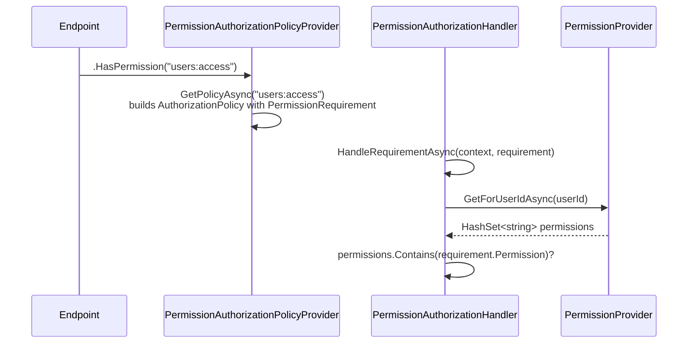

# Authorization

Two layers: JWT bearer authentication (who is the caller), and a custom permission-based
authorization scheme (what can they do) — not ASP.NET Core role membership.

## Authentication — JWT

`Infrastructure/DependencyInjection.cs` → `AddAuthenticationInternal`:

```csharp
services.AddAuthentication(JwtBearerDefaults.AuthenticationScheme)
    .AddJwtBearer(o =>
    {
        o.RequireHttpsMetadata = false;
        o.TokenValidationParameters = new TokenValidationParameters
        {
            IssuerSigningKey = new SymmetricSecurityKey(Encoding.UTF8.GetBytes(configuration["Jwt:Secret"]!)),
            ValidIssuer = configuration["Jwt:Issuer"],
            ValidAudience = configuration["Jwt:Audience"],
            ClockSkew = TimeSpan.Zero
        };
    });
```

Configuration keys (`src/Web.Api/appsettings.json`, shipped empty — set via environment/user
secrets, never commit real values): `Jwt:Secret`, `Jwt:Issuer`, `Jwt:Audience`,
`Jwt:ExpirationInMinutes`.

- **Issuing a token**: `TokenProvider.Create(User user)` (`Infrastructure/Authentication/TokenProvider.cs`)
  builds a `JwtSecurityToken`-equivalent with `sub` = user id, an `email` claim, signed
  `HmacSha256` with `Jwt:Secret`. Called by `LoginUserCommandHandler` on successful login.
- **Reading the current user**: `IUserContext.UserId` (`Application.Abstractions.Authentication`),
  implemented by `Infrastructure/Authentication/UserContext.cs`, which reads
  `IHttpContextAccessor.HttpContext.User` via `ClaimsPrincipalExtensions.GetUserId()`. Inject
  `IUserContext` into any handler that needs "who is calling" — every existing handler that scopes
  a query/mutation to the caller does this (`CreateTodoCommandHandler`,
  `CompleteTodoCommandHandler`, `GetTodosQueryHandler`, ...).

## Authorization — permission-based



Components (`src/Infrastructure/Authorization/`):

- `HasPermissionAttribute : AuthorizeAttribute` — `[HasPermission("users:access")]` for
  attribute-based use; `.HasPermission(string)` (`Web.Api/Extensions/EndpointExtensions.cs`) wraps
  `RequireAuthorization(permission)` for minimal-API endpoints — this is what existing endpoints
  use.
- `PermissionAuthorizationPolicyProvider : DefaultAuthorizationPolicyProvider` — any policy name
  not already registered is treated as a permission string and turned into a dynamically-built
  `AuthorizationPolicy` with a `PermissionRequirement`.
- `PermissionRequirement : IAuthorizationRequirement` — wraps the permission string.
- `PermissionAuthorizationHandler : AuthorizationHandler<PermissionRequirement>` — resolves
  `PermissionProvider` from a fresh `IServiceScope` and checks `permissions.Contains(requirement.Permission)`.
- `PermissionProvider.GetForUserIdAsync(Guid)` — where permissions are looked up per user.

## Permission constants

Declared per-area, `internal const string` on a static `Permissions` class next to the endpoints
that use them:

```csharp
// src/Web.Api/Endpoints/Users/Permissions.cs
internal static class Permissions
{
    internal const string UsersAccess = "users:access";
}
```

## Adding a new permission and protecting an endpoint

1. Add the constant to the aggregate's `Permissions` class (create one,
   `Web.Api/Endpoints/<Aggregate>/Permissions.cs`, if it's the aggregate's first permission).
   Naming convention: `"<area>:<action>"` (`"users:access"`).
2. Apply it on the endpoint: `.HasPermission(Permissions.YourNewPermission)` instead of
   `.RequireAuthorization()`.
3. Make `PermissionProvider.GetForUserIdAsync` return the permission for the users who should have
   it — see the known-gap note below; today it returns nothing for anyone.

## EXISTING — known template placeholder, do not assume it enforces anything yet

```csharp
// Infrastructure/Authorization/PermissionProvider.cs
public Task<HashSet<string>> GetForUserIdAsync(Guid userId)
{
    // TODO: Here you'll implement your logic to fetch permissions.
    HashSet<string> permissionsSet = [];
    return Task.FromResult(permissionsSet);
}
```

```csharp
// Infrastructure/Authorization/PermissionAuthorizationHandler.cs
if (context.User is { Identity.IsAuthenticated: true })
{
    // TODO: Remove this call when you implement the PermissionProvider.GetForUserIdAsync
    context.Succeed(requirement);
    return;
}
```

Both `// TODO`s are in the shipped source. **`PermissionProvider.GetForUserIdAsync` always
returns an empty set, and `PermissionAuthorizationHandler` unconditionally succeeds for any
authenticated user before ever checking that set.** The practical effect: `.HasPermission(...)`
on `Users/GetById` today behaves identically to `.RequireAuthorization()` with no policy — **no
endpoint in this template is actually permission-gated**, regardless of what `.HasPermission(...)`
calls exist in the endpoint code.

**REQUIRED before shipping any project that relies on permission checks**: implement
`PermissionProvider.GetForUserIdAsync` against real storage (a `Permissions`/`RolePermissions`
table, a claims-based source, or an external identity provider), and remove the unconditional
`context.Succeed(requirement)` early-return in `PermissionAuthorizationHandler`. Until both are
done, treat every `.HasPermission(...)` endpoint as equivalent to
`.RequireAuthorization()` — do not represent it as permission-enforced in documentation, tests, or
security review for a real deployment.

## Anonymous endpoints

No `.RequireAuthorization()` and no `.HasPermission(...)` call = anonymous access. There is no
`.AllowAnonymous()` call anywhere in the codebase — omission is how it's expressed
(`Users/Login`, `Users/Register`). Only omit both calls when the endpoint is genuinely meant to be
public.
