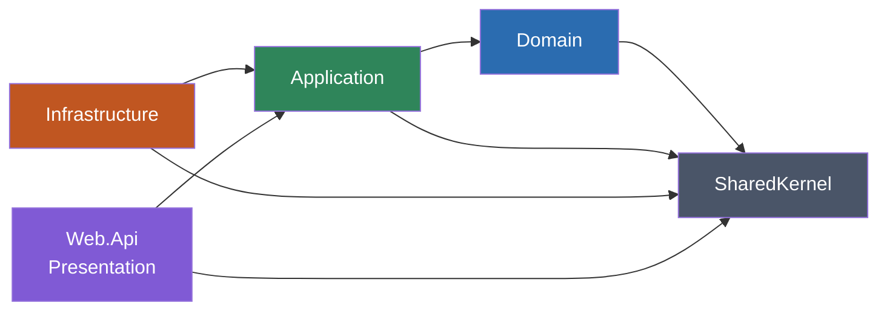
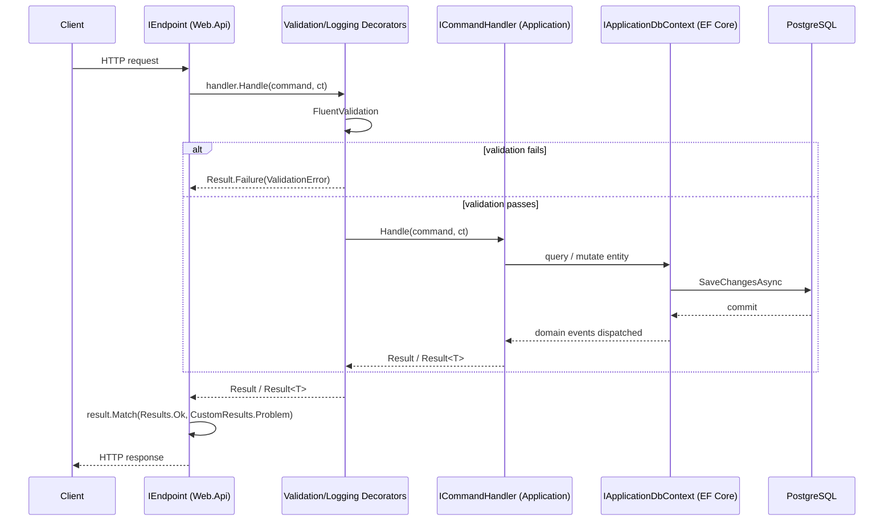

# Architecture Overview

This template implements Clean Architecture as five projects with a single enforced dependency
direction. The rules are not a convention you have to remember — they are asserted by
`tests/ArchitectureTests/Layers/LayerTests.cs` on every build/test run using NetArchTest. A PR
that violates them fails CI.

An arrow means "depends on" / "references the assembly of". Nothing points backward: `Domain`
never references `Application`, `Application` never references `Infrastructure` or `Web.Api`,
`Infrastructure` never references `Web.Api`.

## Project responsibilities

| Project | Responsibility | Depends on |
|---|---|---|
| `SharedKernel` | Cross-cutting DDD primitives used by every layer: `Entity`, `Result`/`Result<T>`, `Error`/`ErrorType`/`ValidationError`, `IDomainEvent`/`IDomainEventHandler`, `IDateTimeProvider`. | nothing in this solution |
| `Domain` | Entities, domain events, and static `*Errors` classes, one folder per aggregate (`Todos/`, `Users/`). No behavior beyond what's on the entity itself. | `SharedKernel` |
| `Application` | Use cases (CQRS commands/queries + handlers), validators, cross-cutting decorators, and the abstraction interfaces (`IApplicationDbContext`, `IUserContext`, `IPasswordHasher`, `ITokenProvider`) that `Infrastructure` implements. | `Domain`, `SharedKernel` |
| `Infrastructure` | EF Core (`ApplicationDbContext`, entity configurations, migrations), JWT authentication, permission-based authorization, domain event dispatch, health checks. Implements every abstraction `Application` declares. | `Application`, `SharedKernel` |
| `Web.Api` | Minimal API endpoints (`IEndpoint`), HTTP composition root (`Program.cs`), Swagger, exception handling, request logging. | `Application`, `SharedKernel` |

Details per layer: [domain.md](./domain.md), [application.md](./application.md),
[infrastructure.md](./infrastructure.md), [presentation.md](./presentation.md). The exact
enforced rules are in [dependency-rules.md](./dependency-rules.md).

## Request flow

Every write path in this template is the same shape: HTTP → endpoint → command handler →
domain/EF Core → `Result` → HTTP response. There is no repository/unit-of-work layer and no
MediatR — CQRS abstractions are hand-rolled in `Application/Abstractions/Messaging`.

## Architectural decisions baked into this template

These are deliberate choices, not gaps — do not "fix" them by reintroducing the pattern they
replace unless the new project's requirements genuinely demand it.

- **No Repository / Unit of Work / Specification layer.** Application handlers depend directly on
  `IApplicationDbContext` (`DbSet<T>` + `SaveChangesAsync`), one handler per use case. See
  [persistence/ef-core.md](../persistence/ef-core.md).
- **No MediatR.** CQRS is four small interfaces (`ICommand`, `ICommand<TResponse>`,
  `ICommandHandler<>`/`ICommandHandler<,>`, `IQuery<TResponse>`/`IQueryHandler<,>`) in
  `Application/Abstractions/Messaging`, wired through Scrutor assembly scanning. See
  [patterns/cqrs.md](../patterns/cqrs.md).
- **`Result`/`Result<T>`, not exceptions, for expected business failure.** Exceptions are reserved
  for truly unexpected failures and are handled centrally by `GlobalExceptionHandler`. See
  [patterns/result-pattern.md](../patterns/result-pattern.md) and
  [patterns/error-handling.md](../patterns/error-handling.md).
- **Minimal APIs, not controllers**, as the sole HTTP presentation mechanism. See
  [api/minimal-api.md](../api/minimal-api.md).
- **Domain events dispatched after `SaveChangesAsync` commits** (eventual consistency, no outbox)
  — an explicit, documented tradeoff in `ApplicationDbContext.SaveChangesAsync`. See
  [patterns/domain-events.md](../patterns/domain-events.md).
- **No message broker wired up.** RabbitMQ/MassTransit/Wolverine are not part of this template as
  shipped — see [messaging/overview.md](../messaging/overview.md) for what's there today and how
  to add messaging if a new project needs it.
- **No OpenTelemetry wired up.** Observability today is Serilog + Seq only — see
  [observability/opentelemetry.md](../observability/opentelemetry.md).

## Stack

- .NET 10 (`net10.0`; most packages also run on .NET 8/9 — see `Directory.Build.props`), C# 12.
- ASP.NET Core Minimal APIs.
- EF Core 10 + Npgsql (PostgreSQL), `EFCore.NamingConventions` for snake_case.
- FluentValidation, Scrutor (assembly-scanning DI registration + decoration).
- Serilog + Seq for structured logging.
- JWT bearer authentication + a custom permission-based authorization scheme.
- xUnit + NetArchTest + Shouldly for architecture tests.
