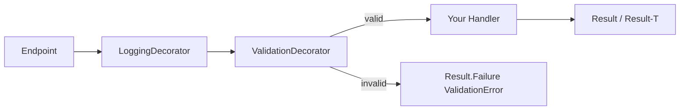

# CQRS

This template separates every use case into a Command (write) or a Query (read), each with
exactly one handler. There is no MediatR — the abstractions are four small interfaces in
`Application/Abstractions/Messaging`, wired up by Scrutor assembly scanning.

## The abstractions

```csharp
// Application/Abstractions/Messaging/ICommand.cs
public interface ICommand;
public interface ICommand<TResponse>;

// Application/Abstractions/Messaging/ICommandHandler.cs
public interface ICommandHandler<in TCommand> where TCommand : ICommand
{
    Task<Result> Handle(TCommand command, CancellationToken cancellationToken);
}
public interface ICommandHandler<in TCommand, TResponse> where TCommand : ICommand<TResponse>
{
    Task<Result<TResponse>> Handle(TCommand command, CancellationToken cancellationToken);
}

// Application/Abstractions/Messaging/IQuery.cs
public interface IQuery<TResponse>;

// Application/Abstractions/Messaging/IQueryHandler.cs
public interface IQueryHandler<in TQuery, TResponse> where TQuery : IQuery<TResponse>
{
    Task<Result<TResponse>> Handle(TQuery query, CancellationToken cancellationToken);
}
```

| Use case shape | Marker interface | Handler interface | Return |
|---|---|---|---|
| Command, no return value | `ICommand` | `ICommandHandler<TCommand>` | `Task<Result>` |
| Command, returns a value | `ICommand<TResponse>` | `ICommandHandler<TCommand, TResponse>` | `Task<Result<TResponse>>` |
| Query | `IQuery<TResponse>` | `IQueryHandler<TQuery, TResponse>` | `Task<Result<TResponse>>` |

There is no `IQueryHandler<TQuery>` without a response — every query returns something.

## Feature folder structure

One folder per use case: `Application/<Aggregate>/<UseCase>/`.

```
Application/Todos/Create/
├── CreateTodoCommand.cs
├── CreateTodoCommandHandler.cs
└── CreateTodoCommandValidator.cs

Application/Todos/Get/
├── GetTodosQuery.cs
├── GetTodosQueryHandler.cs
└── TodoResponse.cs
```

Naming: `<Verb><Aggregate>Command`/`<Verb><Aggregate>Query`, `<Same>Handler`,
`<Same>Validator` (commands only), `<Aggregate>Response` (queries only, when returning a
projection rather than a primitive).

## Example: Command → Validator → Handler → Domain → Result

```csharp
// Command — Application/Todos/Create/CreateTodoCommand.cs
public sealed class CreateTodoCommand : ICommand<Guid>
{
    public Guid UserId { get; set; }
    public string Description { get; set; }
    public DateTime? DueDate { get; set; }
    public List<string> Labels { get; set; } = [];
    public Priority Priority { get; set; }
}

// Validator — Application/Todos/Create/CreateTodoCommandValidator.cs
internal sealed class CreateTodoCommandValidator : AbstractValidator<CreateTodoCommand>
{
    public CreateTodoCommandValidator()
    {
        RuleFor(c => c.UserId).NotEmpty();
        RuleFor(c => c.Priority).IsInEnum();
        RuleFor(c => c.Description).NotEmpty().MaximumLength(255);
        RuleFor(c => c.DueDate).GreaterThanOrEqualTo(DateTime.Today).When(x => x.DueDate.HasValue);
    }
}

// Handler — Application/Todos/Create/CreateTodoCommandHandler.cs
internal sealed class CreateTodoCommandHandler(
    IApplicationDbContext context, IDateTimeProvider dateTimeProvider, IUserContext userContext)
    : ICommandHandler<CreateTodoCommand, Guid>
{
    public async Task<Result<Guid>> Handle(CreateTodoCommand command, CancellationToken cancellationToken)
    {
        if (userContext.UserId != command.UserId)
            return Result.Failure<Guid>(UserErrors.Unauthorized());   // Domain error

        User? user = await context.Users.AsNoTracking()
            .SingleOrDefaultAsync(u => u.Id == command.UserId, cancellationToken);

        if (user is null)
            return Result.Failure<Guid>(UserErrors.NotFound(command.UserId));

        var todoItem = new TodoItem { Id = Guid.NewGuid(), UserId = user.Id, /* ... */ };
        todoItem.Raise(new TodoItemCreatedDomainEvent(todoItem.Id));
        context.TodoItems.Add(todoItem);

        await context.SaveChangesAsync(cancellationToken);

        return todoItem.Id;   // implicit Result<Guid> success via Result<TValue> operator
    }
}
```

(Note: the shipped `CreateTodoCommandValidator` is `public class`, not `internal sealed` — this is
drift from the project's own convention, not the pattern to copy. See
[development/coding-standards.md](../development/coding-standards.md).)

## Example: Query → Handler → Database → Result

```csharp
// Query — Application/Todos/Get/GetTodosQuery.cs
public sealed record GetTodosQuery(Guid UserId) : IQuery<List<TodoResponse>>;

// Handler — Application/Todos/Get/GetTodosQueryHandler.cs
internal sealed class GetTodosQueryHandler(IApplicationDbContext context, IUserContext userContext)
    : IQueryHandler<GetTodosQuery, List<TodoResponse>>
{
    public async Task<Result<List<TodoResponse>>> Handle(GetTodosQuery query, CancellationToken cancellationToken)
    {
        if (query.UserId != userContext.UserId)
            return Result.Failure<List<TodoResponse>>(UserErrors.Unauthorized());

        List<TodoResponse> todos = await context.TodoItems
            .Where(todoItem => todoItem.UserId == query.UserId)
            .Select(todoItem => new TodoResponse { Id = todoItem.Id, /* ... */ })
            .ToListAsync(cancellationToken);

        return todos;
    }
}
```

Queries project directly into a `*Response` DTO with `.Select(...)` — never return a `Domain`
entity, and never call `.AsNoTracking()` on a projected query (there's nothing to track; the
change tracker never materializes an entity instance for a `.Select(...)` result). See
[persistence/ef-core.md](../persistence/ef-core.md) for the full tracking discussion.

## Decorators — registration and execution order

`Application/DependencyInjection.cs`:

```csharp
services.Decorate(typeof(ICommandHandler<,>), typeof(ValidationDecorator.CommandHandler<,>));
services.Decorate(typeof(ICommandHandler<>), typeof(ValidationDecorator.CommandBaseHandler<>));

services.Decorate(typeof(IQueryHandler<,>), typeof(LoggingDecorator.QueryHandler<,>));
services.Decorate(typeof(ICommandHandler<,>), typeof(LoggingDecorator.CommandHandler<,>));
services.Decorate(typeof(ICommandHandler<>), typeof(LoggingDecorator.CommandBaseHandler<>));
```

Scrutor's `Decorate` wraps the innermost registration first with the first `Decorate` call listed
for that type, then each subsequent call wraps the previous decorator. For commands, the effective
call order at runtime is:

```
LoggingDecorator → ValidationDecorator → <your CommandHandler>
```

i.e. validation runs closest to the real handler and short-circuits it on failure; logging wraps
the outcome of validation-or-handler, so both a validation failure and a handler failure are
logged uniformly (`Completed {Command} with error`, with `Error` pushed to Serilog's
`LogContext`). Queries only get `LoggingDecorator` — there is no `ValidationDecorator` for
`IQueryHandler<,>`, so query parameters are never FluentValidation-checked.



## REQUIRED

- Every use case is exactly one Command-or-Query + one Handler. Do not build a handler that both
  mutates and returns rich query data beyond an id, and do not build a "query" that writes.
- `internal sealed` for every handler (matching the majority of existing handlers).
- Commands return `Guid`/nothing; queries return dedicated `*Response` DTOs — never a `Domain`
  entity.

## FORBIDDEN

- Adding MediatR, or any second dispatch mechanism alongside `ICommandHandler`/`IQueryHandler` —
  this template has one CQRS pipeline.
- Business logic inside a decorator — decorators are cross-cutting only (validation, logging).
