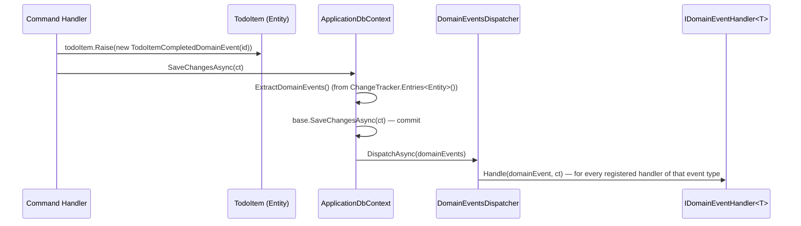

# Domain Events

In-process eventing between an entity's state change and side effects that react to it — email
notifications, cache invalidation, cross-aggregate updates within the same database. This is
**not** a substitute for message-broker integration events; it never crosses a process boundary.
See [messaging/overview.md](../messaging/overview.md) for that distinction if you're evaluating
whether a given event belongs here or on a broker.

## The mechanism



1. **Raise** — an Application command handler calls `entity.Raise(new SomeDomainEvent(...))`
   after mutating the entity. `Entity.Raise` (`SharedKernel/Entity.cs`) just appends to an
   in-memory list; nothing is persisted or dispatched yet.
2. **Extract + commit** — `ApplicationDbContext.SaveChangesAsync`
   (`Infrastructure/Database/ApplicationDbContext.cs`) pulls every tracked entity's
   `DomainEvents`, clears them from the entity, then calls `base.SaveChangesAsync` to commit the
   actual data change.
3. **Dispatch** — only **after** the commit succeeds, `PublishDomainEventsAsync` calls
   `IDomainEventsDispatcher.DispatchAsync(domainEvents)`.
4. **Handle** — `DomainEventsDispatcher` (`Infrastructure/DomainEvents/DomainEventsDispatcher.cs`)
   reflectively resolves and invokes every `IDomainEventHandler<T>` registered for that event's
   concrete type, each in its own DI scope.

```csharp
// src/Infrastructure/Database/ApplicationDbContext.cs
public override async Task<int> SaveChangesAsync(CancellationToken cancellationToken = default)
{
    // When should you publish domain events?
    // 1. BEFORE calling SaveChangesAsync — same transaction, immediate consistency
    // 2. AFTER calling SaveChangesAsync — separate transaction, eventual consistency, handlers can fail
    List<IDomainEvent> domainEvents = ExtractDomainEvents();
    int result = await base.SaveChangesAsync(cancellationToken);
    await PublishDomainEventsAsync(domainEvents);
    return result;
}
```

## Architectural decision: after-commit dispatch, no outbox

This is a **deliberate, documented tradeoff already made by this template** (the comment above is
in the source, not added by this documentation): domain events dispatch after the database write
commits. Consequences to design around, not "fix":

- If `DispatchAsync` throws or a handler fails, **the database write has already committed** — the
  exception propagates up to `GlobalExceptionHandler` as an unhandled exception (HTTP 500), but
  the underlying entity change is not rolled back. The caller sees a 500 for what was, from the
  data's perspective, a successful write.
- There is no outbox table. A crash between commit and dispatch loses the event permanently — it
  is not retried, redelivered, or persisted anywhere.
- This is acceptable for **in-process, best-effort side effects** (the shipped example is a stub:
  "send an email verification link"). It is **not** acceptable as the reliability model for
  anything a new project needs guaranteed delivery for (billing, inventory, anything crossing a
  service boundary) — that requires either dispatching before commit inside the same transaction,
  or introducing a transactional outbox. See [messaging/reliability.md](../messaging/reliability.md)
  and [messaging/overview.md](../messaging/overview.md) if you're adding broker-based messaging on
  top of this.

## Defining and raising an event

```csharp
// src/Domain/Todos/TodoItemCreatedDomainEvent.cs
public sealed record TodoItemCreatedDomainEvent(Guid TodoItemId) : IDomainEvent;
```

```csharp
// inside the command handler, after mutating the entity
todoItem.Raise(new TodoItemCreatedDomainEvent(todoItem.Id));
```

- `sealed record : IDomainEvent`, named past-tense, carrying only the id(s)/data a handler needs —
  not the full entity.
- `Raise(...)` is called from the Application handler, immediately after the mutation it
  corresponds to, before `SaveChangesAsync`.

## Handling an event

```csharp
// src/Application/Users/Register/UserRegisteredDomainEventHandler.cs
internal sealed class UserRegisteredDomainEventHandler : IDomainEventHandler<UserRegisteredDomainEvent>
{
    public Task Handle(UserRegisteredDomainEvent domainEvent, CancellationToken cancellationToken)
    {
        // TODO: Send an email verification link, etc.
        return Task.CompletedTask;
    }
}
```

Handlers implement `SharedKernel.IDomainEventHandler<T>` and live in `Application` (co-located
with the use case that's most related, or in a dedicated folder if the reaction spans
aggregates). `Application/DependencyInjection.cs` registers every `IDomainEventHandler<>`
implementation via Scrutor scan, scoped — **no manual registration required**, just implement the
interface anywhere in the `Application` assembly.

Multiple handlers can subscribe to the same event type; all of them run. Be aware of this when
adding a new handler — check whether one already exists for the event before adding a second, and
give each a name that documents *why* more than one exists if that's genuinely the intent (the
shipped `UserRegisteredDomainEventHandler`/`UserRegisteredDomainEventHandler1` pair in the sample
code is an accidental duplicate stub, not a demonstration of the "multiple handlers" pattern —
don't copy the `...Handler1` naming).

## REQUIRED

- New domain events are `sealed record : IDomainEvent`, past-tense, minimal payload (ids, not
  whole entities).
- Raise events from the Application handler that performs the corresponding mutation, immediately
  after the mutation and before `SaveChangesAsync`.
- Treat domain-event side effects as best-effort/non-critical unless you've explicitly changed the
  dispatch timing or added an outbox — don't build a critical business flow on top of the current
  after-commit, no-retry dispatch without addressing that gap first.

## FORBIDDEN

- Raising a domain event to communicate across a process/service boundary — that's a job for a
  message broker (see [messaging/overview.md](../messaging/overview.md)), not
  `Entity.Raise`/`IDomainEventHandler`.
- Putting business logic that the current transaction depends on inside a domain event handler —
  handlers run after commit; if the outcome must be consistent with the triggering write, it
  belongs in the command handler itself, not a domain event handler.
