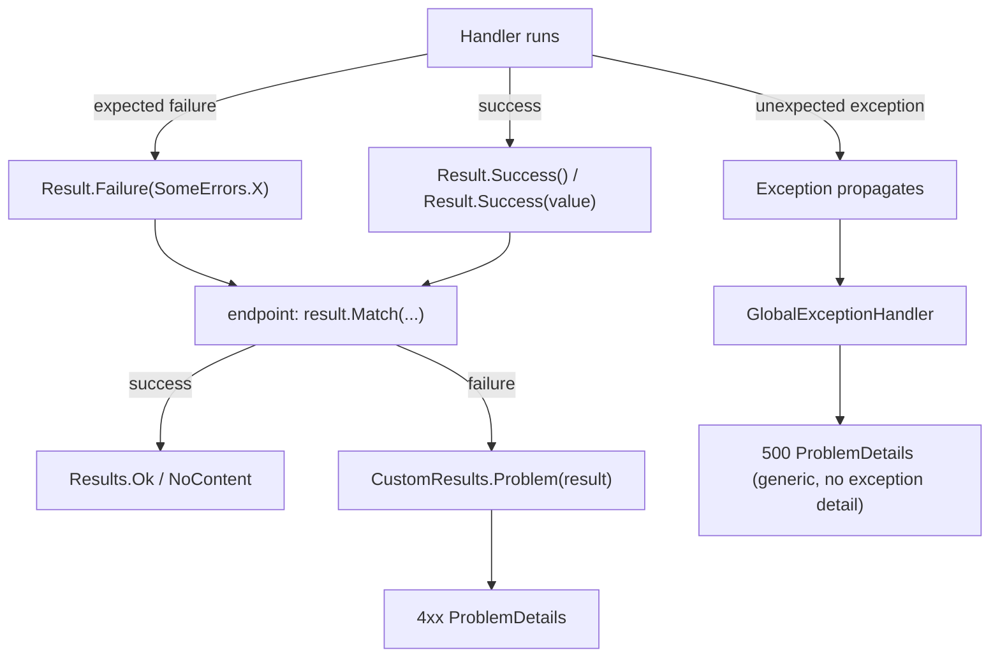

# Error Handling

Two entirely separate paths, and this template never mixes them:

- **Expected business failure** → `Result.Failure(error)` → `CustomResults.Problem` → a specific
  `4xx` `ProblemDetails` response.
- **Unexpected failure** (a bug, an infrastructure fault) → an unhandled exception →
  `GlobalExceptionHandler` → a generic `500` `ProblemDetails` response with no exception details
  leaked to the client.



## `Error` / `ErrorType`

```csharp
// src/SharedKernel/Error.cs
public record Error
{
    public static readonly Error None;
    public static readonly Error NullValue;   // "General.Null"

    public string Code { get; }
    public string Description { get; }
    public ErrorType Type { get; }

    public static Error Failure(string code, string description);  // ErrorType.Failure
    public static Error NotFound(string code, string description);  // ErrorType.NotFound
    public static Error Problem(string code, string description);   // ErrorType.Problem
    public static Error Conflict(string code, string description);  // ErrorType.Conflict
}

// src/SharedKernel/ErrorType.cs
public enum ErrorType { Failure = 0, Validation = 1, Problem = 2, NotFound = 3, Conflict = 4 }
```

`ValidationError` (`SharedKernel/ValidationError.cs`) is a `sealed record : Error` that carries an
`Error[]` and is always `ErrorType.Validation` — used when more than one field failed validation
at once (see [patterns/validation.md](../patterns/validation.md)).

## HTTP status mapping — `CustomResults.Problem`

`Web.Api/Infrastructure/CustomResults.cs` is the **only** place a failed `Result` becomes an HTTP
status code in this template:

| `ErrorType` | HTTP status | `title`/`detail` source |
|---|---|---|
| `Validation` | 400 | `Error.Code` / `Error.Description`, plus an `errors` extension listing every individual `Error` from `ValidationError.Errors` |
| `Problem` | 400 | `Error.Code` / `Error.Description` |
| `NotFound` | 404 | `Error.Code` / `Error.Description` |
| `Conflict` | 409 | `Error.Code` / `Error.Description` |
| `Failure` (or anything unmapped) | 500 | generic `"Server failure"` / `"An unexpected error occurred"` — the actual `Error.Code`/`Description` is **intentionally not leaked** |

```csharp
public static IResult Problem(Result result)
{
    if (result.IsSuccess)
        throw new InvalidOperationException(); // programming error: never call this on success

    return Results.Problem(
        title: GetTitle(result.Error),
        detail: GetDetail(result.Error),
        type: GetType(result.Error.Type),
        statusCode: GetStatusCode(result.Error.Type),
        extensions: GetErrors(result));
}
```

Picking the right `Error` factory in `Domain` determines the HTTP status — a `NotFound` error
always becomes 404, a `Conflict` error always becomes 409, with no per-endpoint override. See
[architecture/domain.md](../architecture/domain.md#errors--errors-static-classes) for choosing
the right factory when adding a new error.

## Endpoint side — `Match`

```csharp
// src/Web.Api/Extensions/ResultExtensions.cs
public static TOut Match<TOut>(this Result result, Func<TOut> onSuccess, Func<Result, TOut> onFailure) =>
    result.IsSuccess ? onSuccess() : onFailure(result);

public static TOut Match<TIn, TOut>(this Result<TIn> result, Func<TIn, TOut> onSuccess, Func<Result<TIn>, TOut> onFailure) =>
    result.IsSuccess ? onSuccess(result.Value) : onFailure(result);
```

```csharp
Result<Guid> result = await handler.Handle(command, cancellationToken);
return result.Match(Results.Ok, CustomResults.Problem);
```

This is the only sanctioned way an endpoint converts a `Result` to an `IResult` — never inspect
`.IsSuccess`/`.Value` manually and branch by hand in an endpoint.

## `GlobalExceptionHandler` — the unexpected-failure path

```csharp
// src/Web.Api/Infrastructure/GlobalExceptionHandler.cs
internal sealed class GlobalExceptionHandler(ILogger<GlobalExceptionHandler> logger) : IExceptionHandler
{
    public async ValueTask<bool> TryHandleAsync(HttpContext httpContext, Exception exception, CancellationToken cancellationToken)
    {
        logger.LogError(exception, "Unhandled exception occurred");

        var problemDetails = new ProblemDetails
        {
            Status = StatusCodes.Status500InternalServerError,
            Type = "https://datatracker.ietf.org/doc/html/rfc7231#section-6.6.1",
            Title = "Server failure"
        };

        httpContext.Response.StatusCode = problemDetails.Status.Value;
        await httpContext.Response.WriteAsJsonAsync(problemDetails, cancellationToken);
        return true;
    }
}
```

Registered via `services.AddExceptionHandler<GlobalExceptionHandler>()` +
`services.AddProblemDetails()` (`Web.Api/DependencyInjection.cs`) and wired into the pipeline with
`app.UseExceptionHandler()` in `Program.cs`. It logs the full exception (server-side only) and
returns a generic 500 with no exception message/stack trace in the response body.

## REQUIRED

1. Every expected/business failure is a `Result.Failure(SomeErrors.X(...))` built from a `Domain`
   `*Errors` factory — never a thrown exception.
2. Endpoints convert `Result`/`Result<T>` to `IResult` only via `result.Match(<success>,
   CustomResults.Problem)`.
3. Do not add per-endpoint try/catch that translates an exception into a custom HTTP response —
   `GlobalExceptionHandler` is the single place for that.
4. When adding a new `Error`, choose the `ErrorType` that matches the intended HTTP status from
   the table above — don't invent a new status-mapping mechanism.

## FORBIDDEN

- Throwing exceptions to signal expected/business failure anywhere in `Domain` or `Application`.
- Building `Results.Problem(...)`/`ProblemDetails` by hand inside an endpoint instead of going
  through `CustomResults.Problem`.
- Leaking exception details (message, stack trace) to the HTTP response for unexpected failures —
  `GlobalExceptionHandler`'s generic response is intentional, not a placeholder to "improve" by
  echoing `exception.Message`.
