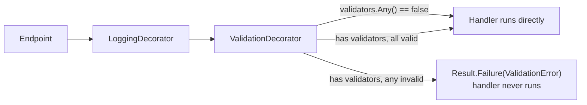

# Validation

Input validation for commands is FluentValidation, run by `ValidationDecorator`, entirely outside
the endpoint. Queries are not validated by this mechanism — `ValidationDecorator` only wraps
`ICommandHandler`/`ICommandHandler<,>`, not `IQueryHandler<,>`.

## Where validation happens



`ValidationDecorator` (`Application/Abstractions/Behaviors/ValidationDecorator.cs`) wraps every
registered `ICommandHandler<,>`/`ICommandHandler<>`:

```csharp
internal sealed class CommandHandler<TCommand, TResponse>(
    ICommandHandler<TCommand, TResponse> innerHandler,
    IEnumerable<IValidator<TCommand>> validators)
    : ICommandHandler<TCommand, TResponse>
    where TCommand : ICommand<TResponse>
{
    public async Task<Result<TResponse>> Handle(TCommand command, CancellationToken cancellationToken)
    {
        ValidationFailure[] validationFailures = await ValidateAsync(command, validators);

        if (validationFailures.Length == 0)
            return await innerHandler.Handle(command, cancellationToken);

        return Result.Failure<TResponse>(CreateValidationError(validationFailures));
    }
}
```

- If **no** `IValidator<TCommand>` is registered for the command type, `validators.Any()` is
  `false` and the decorator no-ops straight into the inner handler — a command with no validator
  is not rejected, it's simply unvalidated.
- If validators exist, all of them run (`Task.WhenAll`), and their failures are merged into one
  `ValidationError` (`SharedKernel.ValidationError`, an `Error` subtype holding an `Error[]`).
- A validation failure **short-circuits** — the real handler, and everything it would have done
  (DB writes, domain events), never runs.

## Writing a validator

```csharp
// Application/Todos/Create/CreateTodoCommandValidator.cs
internal sealed class CreateTodoCommandValidator : AbstractValidator<CreateTodoCommand>
{
    public CreateTodoCommandValidator()
    {
        RuleFor(c => c.UserId).NotEmpty();
        RuleFor(c => c.Priority).IsInEnum();
        RuleFor(c => c.Description).NotEmpty().MaximumLength(255);
        RuleFor(c => c.DueDate).GreaterThanOrEqualTo(DateTime.Today).When(x => x.DueDate.HasValue);
    }
}
```

- `internal sealed class : AbstractValidator<TCommand>`, one file, co-located in the same folder
  as the command (`Application/<Aggregate>/<UseCase>/<Command>Validator.cs`).
- No constructor parameters in any shipped validator — rules that need external state (e.g. "is
  this the caller's own id") belong in the handler, not the validator; FluentValidation here is
  for shape/format rules only (`NotEmpty`, `MaximumLength`, `IsInEnum`, `GreaterThanOrEqualTo`,
  conditional `.When(...)`).
- Registration is automatic: `services.AddValidatorsFromAssembly(typeof(DependencyInjection).Assembly,
  includeInternalTypes: true)` in `Application/DependencyInjection.cs` picks up every
  `AbstractValidator<T>` in the assembly, including `internal` ones — **no manual DI registration
  needed**, just add the class.

**Note on existing drift**: `CreateTodoCommandValidator` and `CopyTodoCommandValidator` are
currently `public class`, not `internal sealed` — this is drift from the project's own
`internal sealed`-by-default convention, not the pattern to copy for new validators.

## Application validation vs. Domain invariants

- **FluentValidation validators** (Application layer) check the shape/format of an incoming
  command *before* any domain or database interaction — required fields, string length, numeric
  ranges, enum membership. They know nothing about persisted state.
- **Business-rule checks that need persisted state or cross-field domain knowledge** (does this
  email already exist, is this todo already completed, does the caller own this resource) are
  **not** validator rules — they're checks inside the handler itself, returning
  `Result.Failure(SomeErrors.X(...))`:

```csharp
// Application/Users/Register/RegisterUserCommandHandler.cs
if (await context.Users.AnyAsync(u => u.Email == command.Email, cancellationToken))
    return Result.Failure<Guid>(UserErrors.EmailNotUnique);
```

- **Domain invariants** (rules an entity itself should never violate) belong on the entity once
  the entity has behavior methods — see
  [architecture/domain.md](../architecture/domain.md#entities) for the current anemic-model state
  and the direction for new aggregates.

Both a validator failure and a handler business-rule failure surface identically to the caller —
`ValidationError`/400 vs. a specific `Error`/400-404-409 — see
[patterns/error-handling.md](../patterns/error-handling.md) for the exact status mapping.

## Missing validators — a known, accepted gap in the sample feature

Not every command has a validator today (`UpdateTodoCommand`, `LoginUserCommand`). For `Login`,
this is defensible — an empty email/password simply fails the lookup/hash check and returns a
uniform not-found error. Do not treat "no validator" as a template pattern to copy by default:
add a validator for any new command with more than one field, so behavior doesn't silently depend
on whether someone remembered to write one.

## REQUIRED

1. Every new command with more than one field gets an `internal sealed class : AbstractValidator<TCommand>`
   in its own folder.
2. Validators check shape/format only — no database or `IUserContext` calls inside a validator.
   Ownership/business-rule checks belong in the handler.
3. Do not add validation logic to `IQueryHandler` — if a query genuinely needs input validation,
   raise it as a handler-level `Result.Failure` (see `GetTodosQueryHandler`'s
   `userContext.UserId` check for the existing pattern), since `ValidationDecorator` does not
   wrap queries.

## FORBIDDEN

- Validating in the endpoint delegate with hand-written `if` checks — see
  [api/minimal-api.md](../api/minimal-api.md#forbidden).
- A `public` (non-`internal sealed`) validator class with no cross-project consumer.
