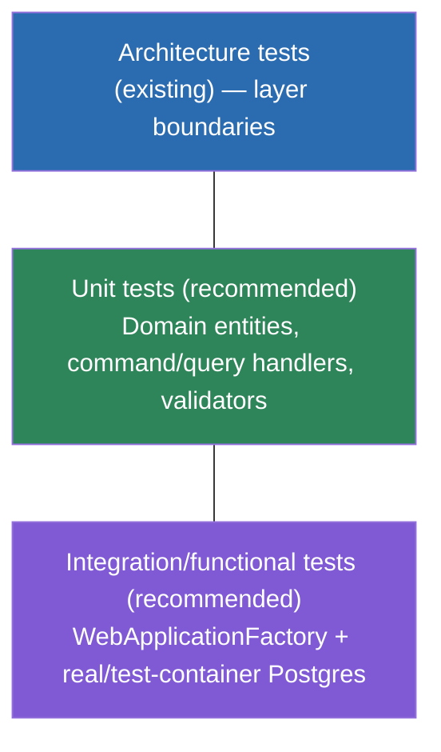

# Testing — Overview

## What exists today

`tests/ArchitectureTests` — the **only** test project in this template. xUnit + NetArchTest +
Shouldly, asserting the six layer-dependency rules in `Layers/LayerTests.cs`. There are **no unit
tests** (no Domain/handler/validator test project) and **no integration/functional tests** (no
`WebApplicationFactory<Program>`-based project) shipped with this template. `Program.cs` already
carries the `namespace Web.Api { public partial class Program; }` shim specifically so a future
functional test project can target it — see `Program.cs`'s `REMARK` comment.

This is a real gap to close in any project built from this template, not a hidden feature. The
pages below describe the intended shape for each test type — layer-by-layer for
architecture tests (already real), and RECOMMENDED for the two types not yet present.

| Test type | Status | Project | Framework |
|---|---|---|---|
| Architecture tests | **EXISTING** | `tests/ArchitectureTests` | xUnit + NetArchTest + Shouldly |
| Unit tests (Domain, handlers, validators) | **RECOMMENDED, not present** | none yet — see [testing/unit-tests.md](./unit-tests.md) | xUnit |
| Integration/functional tests (endpoints, EF Core against real Postgres) | **RECOMMENDED, not present** | none yet — see [testing/integration-tests.md](./integration-tests.md) | xUnit + `WebApplicationFactory<Program>` |

## Running tests

```bash
dotnet test CleanArchitecture.slnx --configuration Release --no-restore --no-build

# a single class/method
dotnet test tests/ArchitectureTests --filter "FullyQualifiedName~LayerTests"
dotnet test tests/ArchitectureTests --filter "FullyQualifiedName~LayerTests.Domain_Should_NotHaveDependencyOnApplication"
```

Mirrors CI (`.github/workflows/build.yml`): restore → build → test → publish against
`CleanArchitecture.slnx`, on `dotnet-version: 10.x`.

## Test pyramid for a project built on this template



- **Architecture tests** run fastest, verify structural rules, already exist. Extend
  `LayerTests.cs` when you add a new layer/rule to enforce — see
  [testing/architecture-tests.md](./architecture-tests.md).
- **Unit tests** exercise a single handler/validator/entity in isolation, mocking or faking only
  the `Application`-owned abstractions (`IApplicationDbContext`, `IUserContext`, etc.) —
  fast, no real database, no HTTP. See [testing/unit-tests.md](./unit-tests.md).
- **Integration/functional tests** exercise the real DI graph (decorators included) end-to-end
  through HTTP, against a real or test-container database. See
  [testing/integration-tests.md](./integration-tests.md).

## Messaging, when added

If [messaging](../messaging/overview.md) is added to a project built on this template, extend the
same pyramid: contract-shape unit tests, consumer-logic unit tests (call the consumer directly,
assert DB state), an explicit double-delivery idempotency test, and end-to-end broker integration
tests against a real/test-container broker for retry/dead-letter behavior — see
[messaging/reliability.md](../messaging/reliability.md#testing) for the specifics; none of this
exists today because messaging itself doesn't.
